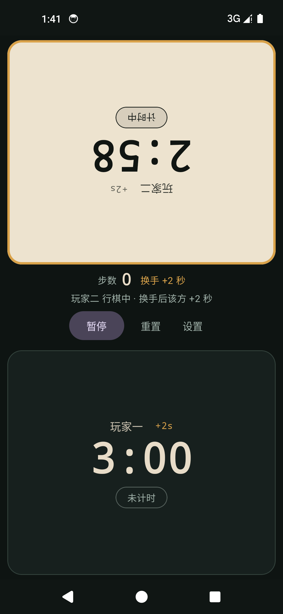

# Chess Clock

Chess Clock 是一款供两人面对面使用的 Android 棋钟。把手机平放在棋盘旁，两位棋手各自面对一块表盘。
除了普通倒计时，还支持每步加秒：选择 3+2 时，每方有 3 分钟，每走完一步加 2 秒。



*对局界面（模拟器截图）：上半屏的表盘倒转，朝向坐在对面的棋手；中央显示步数和三个按钮。*

## 开始一局

在设置页选一个预设（1 分钟、3+2、5 分钟、10 分钟），或者自己填分、秒和每步加秒，然后点「进入对局」。

**点哪一方的表盘，哪一方开始计时。**

- 先点玩家二的表盘：玩家二开始走时，步数还是 0。
- 走完一步后点玩家一的表盘：玩家二停表、玩家一接着走时，步数变成 1。如果选的是 3+2，
  玩家二在这一刻拿到本步的 2 秒，它的表盘旁会短暂显示「+2 秒」。
- 点正在计时的那一方没有作用，不会加秒，也不会加步数。

「暂停」让双方读数停住，「继续」只让原来那一方重新走时。「重置」要确认，确认框打开时会先暂停，
所以读弹窗不会损失时间；取消后原来的计时方继续走。

一方时间归零即判超时：该方停在 0:00 并显示「超时」，另一方不会开始，需要「重置」或从「设置」里开新局。

## 安装到手机

- 需要 Android 8.0（API 26）或更高版本，安装后桌面上的名称是「棋钟」。
- 在 [v1.0.0 发布页](https://github.com/pikaka007/Chess_Clock/releases/tag/v1.0.0) 下载安装包，或从源码构建。
- 构建出来的是 debug 包，安装时需要允许「安装未知应用」，或者用 `adb` 装进去。

## 从源码构建

需要 JDK 17 和 Android SDK 的 platform 34、build-tools 34.0.0。Gradle 不用另装，仓库自带 Gradle Wrapper。

先在仓库根目录建一个 `local.properties` 指向本机 SDK（这个文件不进版本库）：

```properties
sdk.dir=/path/to/android-sdk
```

Windows 路径要写成转义形式，例如 `sdk.dir=C\:\\Android\\Sdk`。

macOS / Linux：

```bash
./gradlew :app:assembleDebug
```

Windows PowerShell：

```powershell
.\gradlew.bat :app:assembleDebug
```

产物在 `app/build/outputs/apk/debug/app-debug.apk`，拷到手机安装，或者直接：

```bash
adb install -r app/build/outputs/apk/debug/app-debug.apk
```

第一次构建要联网下载 Gradle 发行版和依赖，之后可以加 `--offline` 用本地缓存。

单元测试不需要设备：

```bash
./gradlew :app:testDebugUnitTest
```

界面测试要连一台真机或已经启动的模拟器：

```bash
./gradlew :app:connectedDebugAndroidTest
```

把项目放在中文路径下构建时的注意事项记在 [docs/environment.md](docs/environment.md)。

## 目前的范围

- 中文界面，固定深色主题。
- 只做计时：没有棋盘、记谱、多阶段时限、声音和对局历史。
- 提供的是 debug 构建，没有做正式签名。
- 团队已完成 Android 手机验证。自动化测试环境为 Android 14 模拟器。

## 更多

[开发记录](docs/development/README.md) · [验证结果](docs/verification.md)
